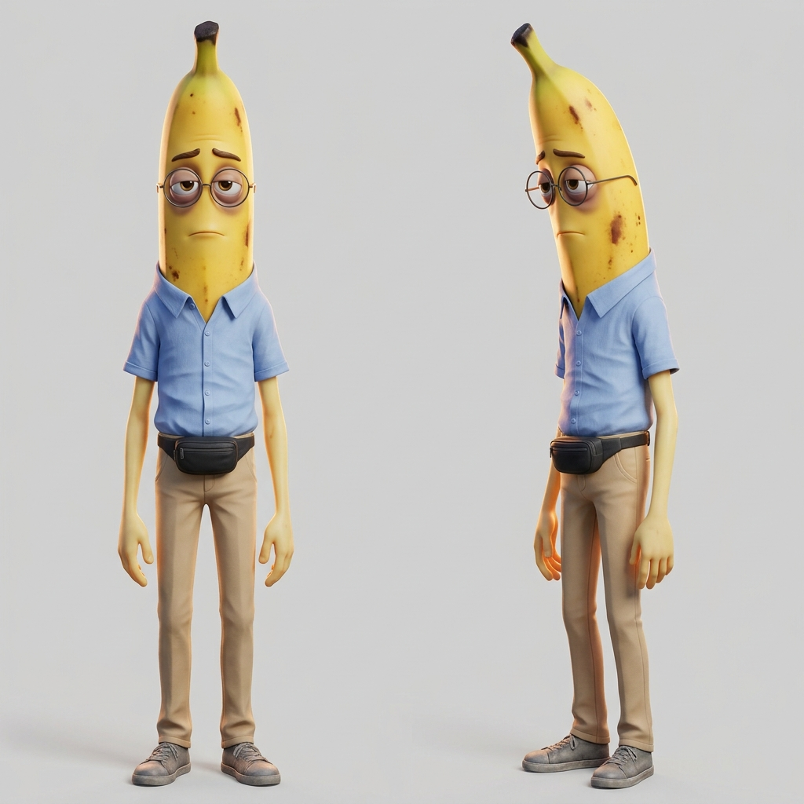

# Bananildo: descrição física



O beta da novela das frutas: um homem comum, magro e sempre cansado, gentil até demais, que vira o ombro amigo de todas e nunca é o escolhido.

**Tipo.** Banana humanizada, homem adulto comum, uns 35 anos.

**Porte e silhueta.** Alto, magro e desengonçado: ombros estreitos e caídos, braços finos, um pouco curvado, como quem carrega o dia inteiro nas costas.

**Rosto.** A cabeça é uma banana comprida e levemente curva. Olhos caídos e cansados, com olheiras fundas; sobrancelhas finas, sempre um pouco preocupadas; óculos redondos de aro fino.

**Cabelo.** Não tem: no alto da cabeça, a pontinha escura do cabo da banana.

**Pele e textura.** Amarelo-banana pálido, com algumas manchinhas marrons de banana passando do ponto na cabeça.

**Roupa.** Camisa social azul-clara de manga curta, amassada; calça chino bege; tênis cinza gasto.

**Acessórios.** Pochete preta na cintura e os óculos redondos de aro fino.

**Traço marcante.** As olheiras, os óculos redondos e as manchinhas marrons na casca: o cansaço aparece até na fruta. De longe, a pochete preta e a postura curvada.

**Paleta.** Amarelo-banana pálido, azul-claro, bege e cinza: cores apagadas, de quem passa despercebido.

## Estilo da imagem

**Animação 3D de estúdio.** Animação 3D polida de longa-metragem, como a da novela das frutas: texturas lisas e brilhantes, cores saturadas, luz de cinema quente.

## Descrição para os prompts (inglês)

Vai, palavra por palavra, em `personagens[].descricao` da bíblia visual de um projeto, com a `referencia_en` "Bananildo the banana", para o personagem sair igual em todas as cenas.

> Bananildo the banana, an anthropomorphic banana adult man, his head a long slightly curved yellow banana with a few brown ripening spots and a dark stem tip on top, tired droopy eyes with dark circles, thin worried eyebrows, thin round wire-frame glasses, a tall skinny lanky body with narrow sloping shoulders and a slight slouch, pale banana-yellow skin, wearing a wrinkled short-sleeved light-blue button-up shirt, beige chino pants, worn gray sneakers and a black fanny pack around his waist

## Geração

- **Modelo:** gemini-3.1-flash-image · **proporção:** 1:1
- **Versão aprovada:** v1 de `rascunhos/personagens/bananildo`, gerada em 2026-10-21T08:51:55, aprovada em 2026-10-21
- **Negativo:** text, letters, watermark, logo, brand name, real people, human head, muscles, muscular build, nudity, extra limbs, extra fingers, deformed hands, blurry face, photorealistic

Prompt:

```text
Character reference sheet. Bananildo the banana, an anthropomorphic banana adult man, his head a long slightly curved yellow banana with a few brown ripening spots and a dark stem tip on top, tired droopy eyes with dark circles, thin worried eyebrows, thin round wire-frame glasses, a tall skinny lanky body with narrow sloping shoulders and a slight slouch, pale banana-yellow skin, wearing a wrinkled short-sleeved light-blue button-up shirt, beige chino pants, worn gray sneakers and a black fanny pack around his waist. Front view and three-quarter view, full body, neutral expression, plain light gray background. Style: big-budget 3D animated feature film still, stylized CGI, anthropomorphic fruit character with oversized glossy expressive eyes and adult proportions, smooth polished textures with soft subsurface scattering, vibrant saturated colors, soft warm cinematic lighting with gentle rim light.
```

---

Gerado por `skills/criar-personagem/scripts/personagem.py` a partir de `personagem.json`. Para mudar o personagem, use a skill `criar-personagem`.
