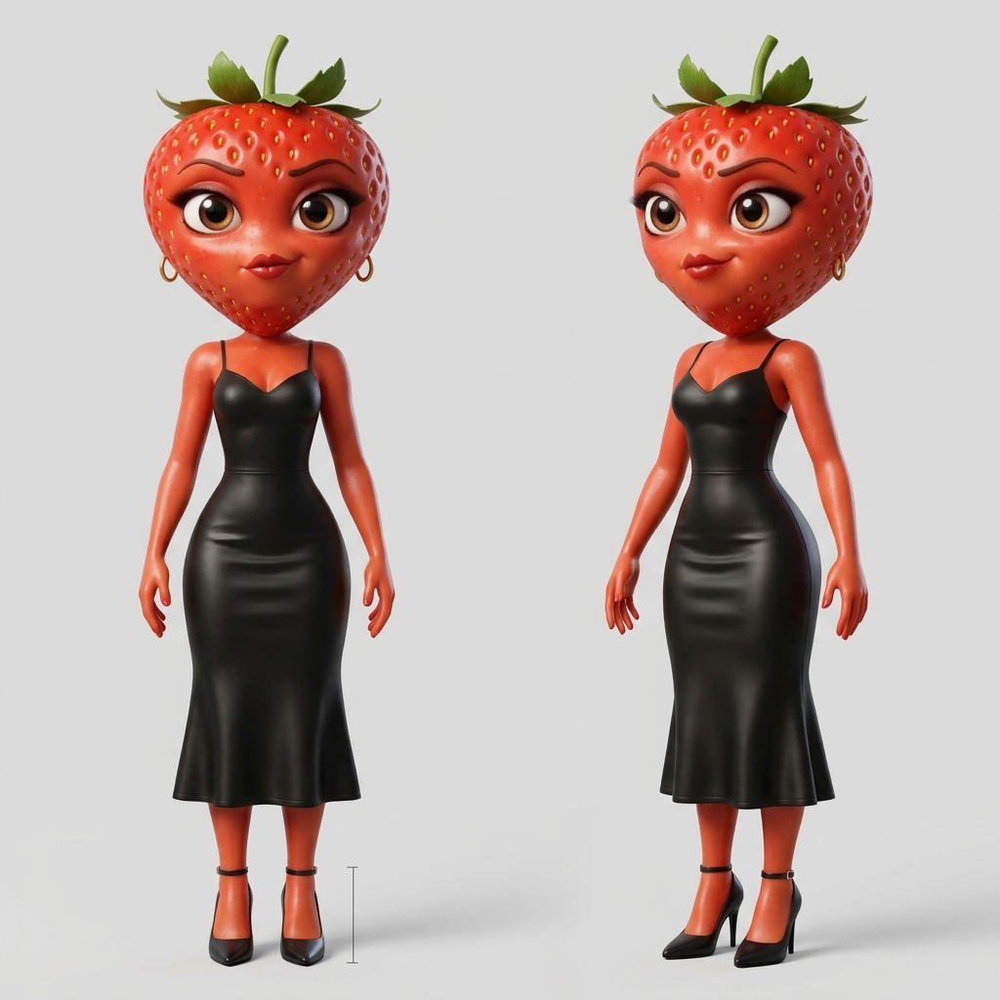

# Moranguete: descrição física



A estrela da novela das frutas: um morango com corpo de mulher, vaidosa e teatral, que num vídeo é a heroína sofredora e no outro a vilã charmosa, doce na frente e calculista por trás.

**Tipo.** Morango humanizado, mulher adulta.

**Porte e silhueta.** Corpo de mulher adulta, curvilíneo: cintura fina, quadril largo, braços finos e pernas longas. Postura confiante, de quem sabe que está sendo olhada.

**Rosto.** A cabeça é um morango grande. Olhos castanhos enormes e brilhantes, cílios longos e escuros, sobrancelhas finas e arqueadas, nariz pequeno, lábios cheios em vermelho-escuro brilhante.

**Cabelo.** Não tem: no lugar, uma coroa de folhas verdes com um cabinho curto no alto da cabeça.

**Pele e textura.** Vermelho-morango brilhante no corpo todo, com sementinhas douradas na cabeça.

**Roupa.** Sem roupa padrão: muda a cada vídeo, sempre justa e chamativa (vestido de alça, saia lápis, uniforme ajustado). A roupa de cada vídeo vai na bíblia visual do projeto, junto da descrição dela. Na ficha, ela usa o vestido preto justo de alça e o salto preto da imagem de referência.

**Acessórios.** Brincos pequenos de argola dourada, em todos os vídeos.

**Traço marcante.** A cabeça de morango com a coroa de folhas, os olhos castanhos de cílios longos e os brincos de argola dourada. Como a roupa muda, é por eles que o espectador a reconhece.

**Paleta.** Vermelho-morango, verde-folha, dourado e a cor da roupa do vídeo (preto na ficha).

## Estilo da imagem

**Animação 3D de estúdio.** Animação 3D polida de longa-metragem, como a da novela das frutas: texturas lisas e brilhantes, cores saturadas, luz de cinema quente.

## Descrição para os prompts (inglês)

Vai, palavra por palavra, em `personagens[].descricao` da bíblia visual de um projeto, com a `referencia_en` "Moranguete the strawberry", para o personagem sair igual em todas as cenas.

> Moranguete the strawberry, an anthropomorphic strawberry adult woman, her head a large glossy bright-red strawberry dotted with tiny golden seeds and topped with a crown of green leaves and a short stem, big sparkling brown eyes with long dark lashes, thin arched dark eyebrows, full glossy deep-red lips, small gold hoop earrings, a curvy hourglass figure with slender arms and long legs, smooth glossy strawberry-red skin

## Geração

- **Modelo:** gemini-3.1-flash-image · **proporção:** 1:1
- **Versão aprovada:** v1 de `rascunhos/personagens/moranguete`, gerada em 2026-10-21T08:36:44, aprovada em 2026-10-21
- **Feita a partir de:** `rascunhos/personagens/moranguete/referencia-usuario.png`, com o ajuste "turn this picture into a clean character reference sheet on a plain light gray background, keeping her outfit from the picture: a fitted black satin spaghetti-strap midi dress and black ankle-strap heels"
- **Negativo:** text, letters, watermark, logo, brand name, real people, human head, nudity, lingerie, cleavage, suggestive pose, extra limbs, extra fingers, deformed hands, blurry face, photorealistic

Prompt:

```text
Character reference sheet. Moranguete the strawberry, an anthropomorphic strawberry adult woman, her head a large glossy bright-red strawberry dotted with tiny golden seeds and topped with a crown of green leaves and a short stem, big sparkling brown eyes with long dark lashes, thin arched dark eyebrows, full glossy deep-red lips, small gold hoop earrings, a curvy hourglass figure with slender arms and long legs, smooth glossy strawberry-red skin. Front view and three-quarter view, full body, neutral expression, plain light gray background. Style: big-budget 3D animated feature film still, stylized CGI, anthropomorphic fruit character with oversized glossy expressive eyes and adult proportions, smooth polished textures with soft subsurface scattering, vibrant saturated colors, soft warm cinematic lighting with gentle rim light.
```

---

Gerado por `skills/criar-personagem/scripts/personagem.py` a partir de `personagem.json`. Para mudar o personagem, use a skill `criar-personagem`.
