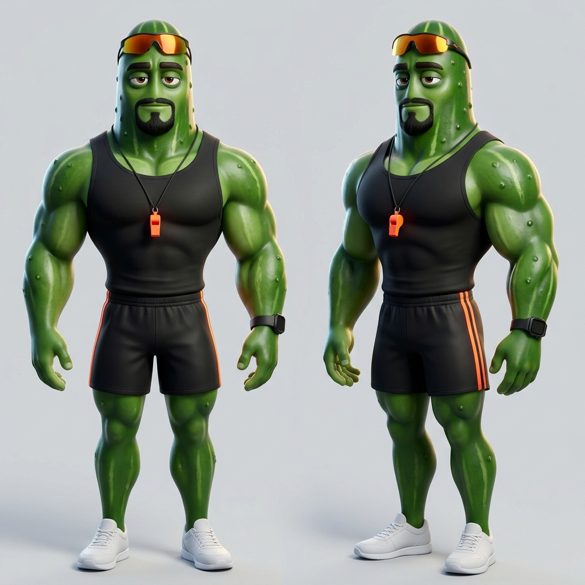

# Pepinudo: descrição física



Personal trainer da novela das frutas: um pepino sarado, convencido e cafajeste, que trata toda aluna como a única e nunca assume ninguém.

**Tipo.** Pepino humanizado, homem adulto, uns 30 anos.

**Porte e silhueta.** Alto e muito musculoso, de fisiculturista: braços enormes, ombros e peito largos, tronco em V, cintura fina, pernas grossas e musculosas. Postura de quem está sempre posando, peito estufado.

**Rosto.** A cabeça é um pepino brilhante do tamanho de uma cabeça humana. Olhos castanho-escuros de pálpebras pesadas, sobrancelhas grossas e escuras, cavanhaque preto curto e bem aparado.

**Cabelo.** Não tem: no alto da cabeça ficam os óculos esportivos espelhados laranja, sempre puxados para cima.

**Pele e textura.** Verde-pepino escuro e brilhante, com pequenas saliências e listras verde-claras na cabeça; verde-pepino no corpo.

**Roupa.** De personal trainer: regata preta justa, sem logo; bermuda esportiva preta com faixa laranja-neon nas laterais; tênis brancos.

**Acessórios.** Apito laranja-neon num cordão preto no pescoço e relógio esportivo digital preto no pulso.

**Traço marcante.** Os óculos espelhados laranja no alto da cabeça e o cavanhaque preto; de longe, o laranja-neon do apito e da bermuda.

**Paleta.** Verde-pepino, preto, laranja-neon e branco.

## Estilo da imagem

**Animação 3D de estúdio.** Animação 3D polida de longa-metragem, como a da novela das frutas: texturas lisas e brilhantes, cores saturadas, luz de cinema quente.

## Descrição para os prompts (inglês)

Vai, palavra por palavra, em `personagens[].descricao` da bíblia visual de um projeto, com a `referencia_en` "Pepinudo the cucumber", para o personagem sair igual em todas as cenas.

> Pepinudo the cucumber, an anthropomorphic cucumber adult man, his head a human-sized glossy dark-green cucumber with bumps and pale green stripes, heavy-lidded dark-brown eyes, thick dark eyebrows, a trimmed black goatee, mirrored orange sports sunglasses pushed up on his head, a tall heavily muscular bodybuilder physique with huge arms, broad shoulders and chest, V-shaped torso, narrow waist and thick muscular legs, cucumber-green skin, wearing a tight black sleeveless tank top, black shorts with neon-orange side stripes, white sneakers, a neon-orange whistle on a black lanyard and a black digital sports watch

## Geração

- **Modelo:** gemini-3.1-flash-image · **proporção:** 1:1
- **Versão aprovada:** v4 de `rascunhos/personagens/pepinudo`, gerada em 2026-10-21T08:47:25, aprovada em 2026-10-21
- **Negativo:** text, letters, watermark, logo, brand name, real people, human head, nudity, shirtless, bare torso, underwear, suggestive pose, extra limbs, extra fingers, deformed hands, blurry face, photorealistic

Prompt:

```text
Character reference sheet. Pepinudo the cucumber, an anthropomorphic cucumber adult man, his head a human-sized glossy dark-green cucumber with bumps and pale green stripes, heavy-lidded dark-brown eyes, thick dark eyebrows, a trimmed black goatee, mirrored orange sports sunglasses pushed up on his head, a tall heavily muscular bodybuilder physique with huge arms, broad shoulders and chest, V-shaped torso, narrow waist and thick muscular legs, cucumber-green skin, wearing a tight black sleeveless tank top, black shorts with neon-orange side stripes, white sneakers, a neon-orange whistle on a black lanyard and a black digital sports watch. Front view and three-quarter view, full body, neutral expression, plain light gray background. Style: big-budget 3D animated feature film still, stylized CGI, anthropomorphic fruit character with oversized glossy expressive eyes and adult proportions, smooth polished textures with soft subsurface scattering, vibrant saturated colors, soft warm cinematic lighting with gentle rim light.
```

---

Gerado por `skills/criar-personagem/scripts/personagem.py` a partir de `personagem.json`. Para mudar o personagem, use a skill `criar-personagem`.
